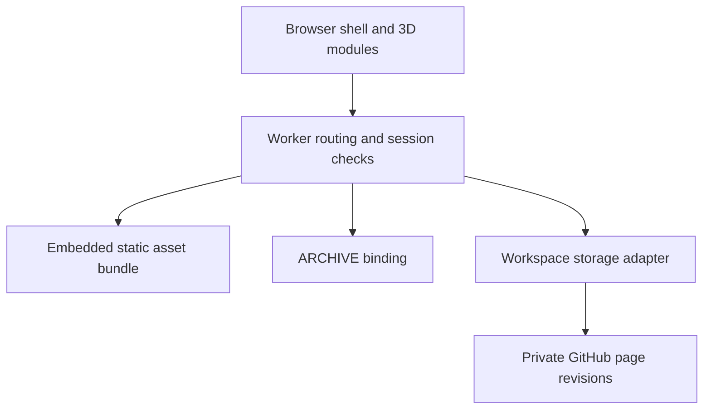

# Workspace application: architecture and operation

## Implemented source boundaries

The curated public app is a privacy-sanitized historical Cloudflare Worker export.
Its reference JSON and AWS target diagrams have separate source provenance.
This document maps the implementation, not a proposed AWS deployment.



`worker/build.mjs` packages static resources; `worker/index.mjs` checks signed
sessions and routes requests; `worker/workspace-store.mjs` bounds page inputs,
encrypts the connection token, verifies private repository visibility and uses
the last-read content SHA to prevent silent overwrite. Tokens and runtime data
are absent from this public export.

## Standalone local preview

From `app/`:

```sh
node worker/build.mjs
node worker/preview.mjs
```

Open the printed loopback URL. Use the synthetic preview login printed by the
command; the ephemeral in-memory archive is lost when the process exits.
The helper does not use real credentials or connect a backing repository.
It reads only included large assets; it no longer requires the omitted reference
ZIP or an unrelated sibling checkout. It preserves the application's sign-in
checks and does not simulate a verified production identity.

```sh
node worker/test.mjs
node worker/test-workspace-store.mjs
node --test worker/preview.test.mjs
```

The preview transport rejects oversized bodies before passing requests to the
Worker. It binds loopback only. Its memory store is a developer fixture and must
not be deployed as persistent storage. Links to external hosted sites are not
rewritten or verified by local preview.

## Maintainability and scale limits

Keep authoring modules distinct from generated `dist/server/`. Preserve source
receipts when changing a maintained derivative; update the export's current
manifest separately from immutable source identity. Run design validation after
README/manifest changes. Keep private source records out of public tests.

The current login throttle is a read-modify-write record in ARCHIVE, not a proven
atomic distributed rate limiter. Session records need operational expiry/cleanup;
cross-instance behavior depends on the real binding consistency. The GitHub
adapter limits individual pages to 256 KiB and directory listings to 1,000 entries.
These are explicit bounds, not evidence of sustained concurrent scale.

Before higher traffic: measure bundle transfer and memory, login latency,
ARCHIVE consistency and GitHub conflict/rate-limit frequency. Use a platform
atomic throttle or durable coordinator if distributed abuse protection is needed;
use verified session expiration and scoped cache policies. Do not cache private
workspace responses publicly. A future collaborative editor needs transactional
revision/conflict semantics, authorization and restore tests before replacing the
small-file store. No cloud changes or throughput claims accompany this patch.

