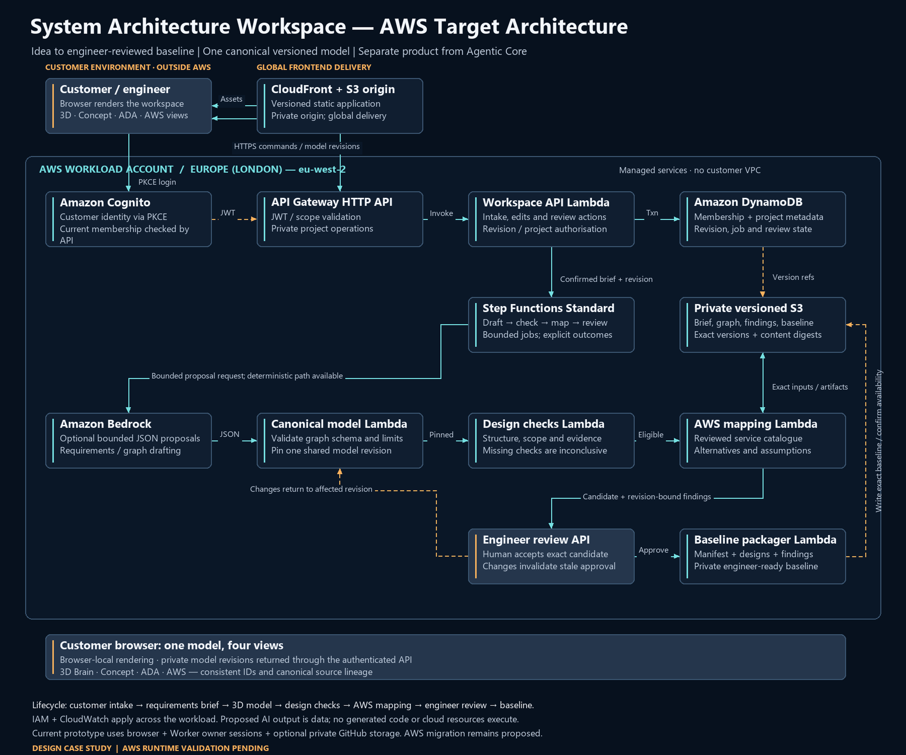

# System Architecture Workspace Architecture Views

These are authored case-study artifacts from Site v81, source commit `4f583cb90bff726eada9a180a0eeba4118981a73` (24 October 2026, 13:40 UTC). The copied files preserve exact source bytes; [the manifest](diagram-manifest.json) records provenance and hashes.

- [Editable SVG](System-Architecture-Workspace-AWS-Target.svg)
- [AWS case study and six-pillar decisions](System-Architecture-Workspace-AWS-Case-Study.md)
- [Shared authored case-study data](Case-Study-Source-Data.json)

The implemented browser/Worker prototype and its optional private revision storage are separate from this proposed AWS migration. The diagram shows a future path through a requirements brief, one canonical model, deterministic checks, AWS mapping, engineer review and a baseline package.

Generated architecture data does not automatically provision cloud resources. The AWS migration, model-driven generation, broad customer tenancy and cloud validation remain pending. The source data describes design assumptions, not measured production telemetry.
